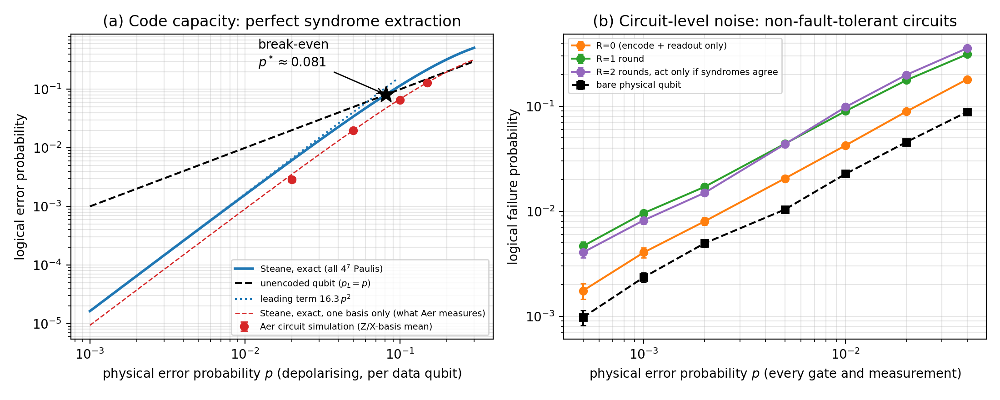

# A logical qubit with the Steane code (Qiskit)

**Team:** Ouroboros
**Members:** Amritup Vats, Saumya Baskar, Amritash Mishra, Krish Majhi
**Track / Problem:** Track 4, Problem 7: A logical qubit with the Steane code (core tasks 1-4 plus three stretch goals)
**Python version:** 3.12.3

## Summary

We build the [[7,1,3]] Steane code from scratch in Qiskit: encoder, six-stabiliser syndrome extraction with ancillas, a lookup-table decoder run *inside* the circuit with mid-circuit measurement and `if_test` feed-forward, and transversal logical gates (X, Z, H, S†, and CNOT between two blocks). All 21 single-qubit Pauli errors are detected and corrected with fidelity 1 on five test states; two-error behaviour is measured exactly (147 of the 189 weight-2 Pauli errors cause a logical error). Logical vs physical error rate is computed **exactly** by enumerating all 4^7 Pauli errors (code-capacity break-even at p* = 0.081, leading term 16.3 p²) and cross-checked with Aer circuit simulation. With circuit-level noise and our *non-fault-tolerant* circuits the encoded qubit is **worse** than a bare qubit at every noise level tested; we report this as a result, not a bug.

## Main result



(a) Exact logical error probability of the Steane code under depolarising noise against the unencoded qubit (dashed black), break-even at p* ≈ 0.081; red points are Aer circuit simulations on the matching one-basis curve. (b) With every gate and measurement noisy, our non-fault-tolerant circuits do not beat a bare physical qubit.

## How to reproduce (clean start)

```bash
python -m venv .venv
source .venv/bin/activate          # Windows: .venv\Scripts\activate
pip install -r requirements.txt
pytest -q tests                    # 7 checks against exact references, ~20 s
python src/main.py                 # all numbers and figures, ~3 min  (use --quick for ~1 min)
python src/check_noise_model.py    # optional 1M-shot check of the Aer noise convention, ~1 min
python src/build_writeup.py        # regenerates WRITEUP.pdf from results.json
```

- Expected runtime: about 3 minutes for `main.py` on a laptop (Aer stabiliser simulator)
- Random seed(s) used: 42 (Aer `seed_simulator`), 7 (test-state generator)
- Output: the main figure is written to `figures/main_result.png`; all numbers go to `results.json`
- Needs an IBM Quantum account? No. Everything runs on the local Aer simulator.

## Repository contents

| Path | What it is |
|------|------------|
| `WRITEUP.pdf` | Write-up (2-4 pages): Problem, Method, Results, Honest limits |
| `AI_USE_NOTE.md` | Tools used, one thing the AI got wrong, how we caught it |
| `DEMO_GUIDE.md` | 5-minute demo script and answers to likely questions |
| `src/steane.py` | The code itself: stabilisers, encoder, syndrome extraction, lookup, exact enumeration |
| `src/experiments.py` | Circuits: 21-error test, transversal gates, noisy memory experiments |
| `src/main.py` | Runs everything and writes figures and `results.json` |
| `tests/` | Checks against exact references (pytest) |
| `figures/` | All figures used in the write-up |
| `requirements.txt` | Pinned package versions |

## What is simulated

- **Single-error table, transversal gates, Bell-pair check:** noiseless physical circuit simulation (Aer statevector, or exact linear algebra for the gate checks). Corrections run in-circuit with `if_test`.
- **Code-capacity curve (a):** the solid line is an **exact enumeration** of all 4^7 Pauli errors (a statistical-free calculation, not a circuit simulation); red points are Aer stabiliser-circuit simulations with noise only on the data qubits.
- **Circuit-level curves (b):** Aer stabiliser simulation with depolarising noise after every gate and readout flips. The per-round corrections are applied **in classical post-processing** (a Pauli frame), which is mathematically equivalent to feed-forward for Pauli corrections but is a shortcut compared with `if_test`.

## Hardware run (optional bonus)

Not done (no IBM Quantum access during the build).

## Honest limits (short version)

Syndrome extraction uses one bare ancilla per stabiliser and is not fault tolerant, so a single faulty gate can corrupt several data qubits; this is why circuit-level logical error does not beat the bare qubit. No flag qubits, no hardware, depolarising noise only. Full discussion in `WRITEUP.pdf`.

## Credits

Qiskit 2.6.0 and Qiskit Aer 0.17.2; A. M. Steane, "Error correcting codes in quantum theory", PRL 77, 793 (1996); Nielsen & Chuang, ch. 10; code written with Claude (Anthropic), see `AI_USE_NOTE.md`.
