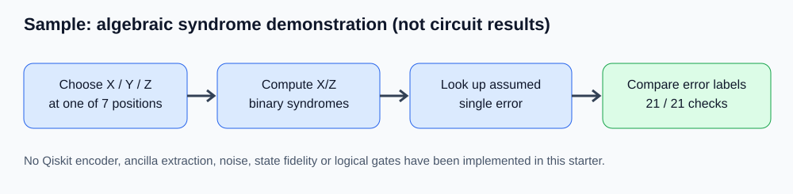

# Steane [[7,1,3]] Quantum Error Correction — Sample Submission

> **SAMPLE / WORK IN PROGRESS:** This repository is a starter for **P7 — Steane Quantum Error Correction**. The demonstration currently uses classical binary syndrome algebra only. It is **not** an implementation of encoded quantum circuits, ancilla-based syndrome measurements, or logical gates. Replace example content with your team's actual work before submitting.

**Team:** [YOUR TEAM NAME]  
**Members:** [MEMBER 1], [MEMBER 2], [MEMBER 3]  
**Track / Problem:** P7 — Steane Quantum Error Correction  
**Python version:** 3.10+ (sample implementation uses only Python standard library)

## Summary

The Steane [[7,1,3]] code encodes one logical qubit into seven physical qubits and can correct an arbitrary single-qubit Pauli error. Our planned project will build the encoder, extract X- and Z-type stabilizer syndromes with ancillas, apply Pauli corrections, and demonstrate a transversal logical gate in Qiskit. **Currently included:** a minimal algebra-only syndrome lookup example for X, Y, Z errors on seven sites.

## Main result (sample only)



The example runs 21 algebraic checks: 7 positions × {X, Y, Z}. Each check uses a binary parity-check matrix, decodes the predicted syndrome, and verifies the error label. **These are not quantum state-fidelity results or error-correction circuit measurements.**

## Reproduce the sample

```bash
python -m venv .venv
# macOS/Linux: source .venv/bin/activate
# Windows PowerShell: .venv\Scripts\Activate.ps1
python -m pip install -r requirements.txt
python -m unittest discover -s tests -v
python -m src.main
```

No IBM Quantum account or hardware access is needed for the starter example. Expected runtime: under a few seconds. No random seeds, statistical sampling, or shots are used.

Expected demo summary: `21/21 algebraic single-qubit Pauli checks passed`.

## Planned quantum implementation — not yet present

- [ ] Construct and verify an encoded logical state with seven physical qubits
- [ ] Implement the six Steane stabilizers and ancilla-based syndrome extraction
- [ ] Inject all 21 single-qubit X/Y/Z errors into a quantum circuit and correct them
- [ ] Check recovered logical information or state fidelity
- [ ] Implement and test at least one transversal logical gate (e.g. logical H)
- [ ] Investigate two-qubit errors and/or physical-versus-logical error-rate curves
- [ ] Produce measured or simulated results and comparison figure

## Repository contents

| Path | Description |
| --- | --- |
| `src/main.py` | Runs the **algebra-only** demonstration |
| `src/steane_syndrome.py` | Binary Hamming parity-check matrix and lookup decoder |
| `tests/test_steane_syndrome.py` | Deterministic tests for the algebraic example |
| `figures/sample_workflow.svg` | Illustrative workflow diagram (**not data**) |
| `WRITEUP_TEMPLATE.md` | Starting outline for the required 2–4 page PDF |
| `AI_USE_NOTE.md` | AI disclosure placeholder to fill honestly |
| `SUBMISSION_CHECKLIST.md` | Organizers' checklist, annotated by status |
| `requirements.txt` | No external dependencies for this preliminary example |

## What is simulated / verified

Only **classical symplectic error-label/syndrome arithmetic** is executed: X and Z error components are bit masks; parity checks and correction lookup are computed mathematically. No quantum states, Qiskit circuits, physical noise, stabilizer measurement devices, or IBM hardware are simulated by this starter.

## Honest limits

Passing 21 algebraic checks does **not** prove a working fault-tolerant error-correction circuit. There are no ancillas, measurement outcomes, gate errors, quantum noise models, timing, or logical fidelity measurements. All planned circuit-based claims require later implementation and testing.

## Credits

- Standard [[7,1,3]] Steane CSS-code construction from the classical [7,4,3] Hamming code.
- Starter repository scaffold and example prose were prepared with AI assistance; verification and final disclosure remain the team's responsibility.

## Before submitting

Replace placeholders, produce `WRITEUP.pdf` (2–4 pages), replace the illustrative figure with your real results, pin every installed external package after adding dependencies, fill the AI-use note with a **real observed mistake and how you caught it**, and run the organizer's submission checker.
